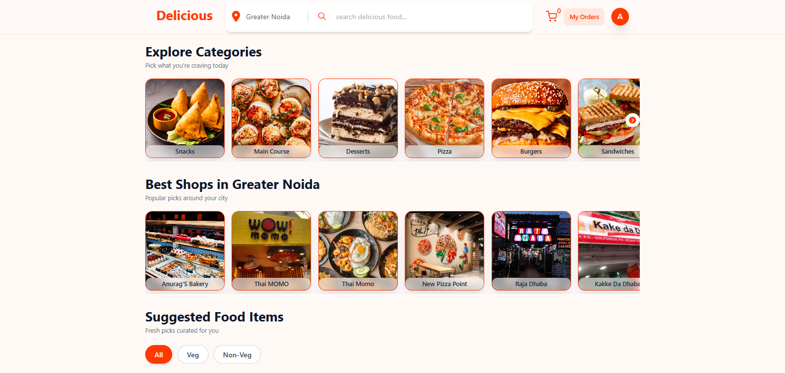
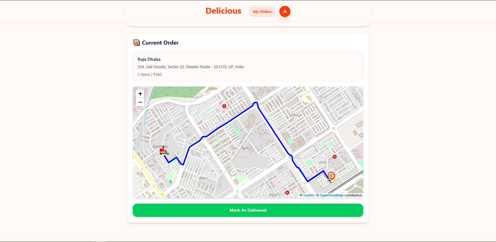
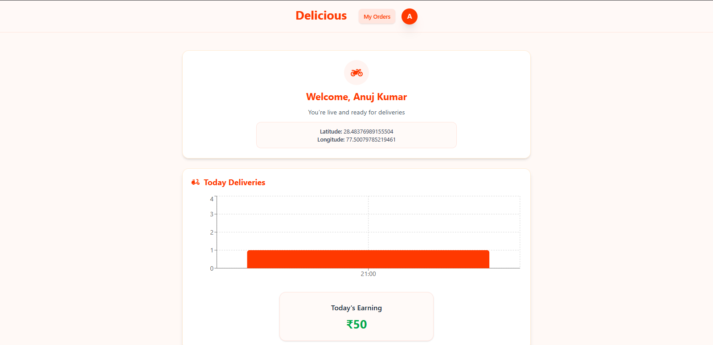
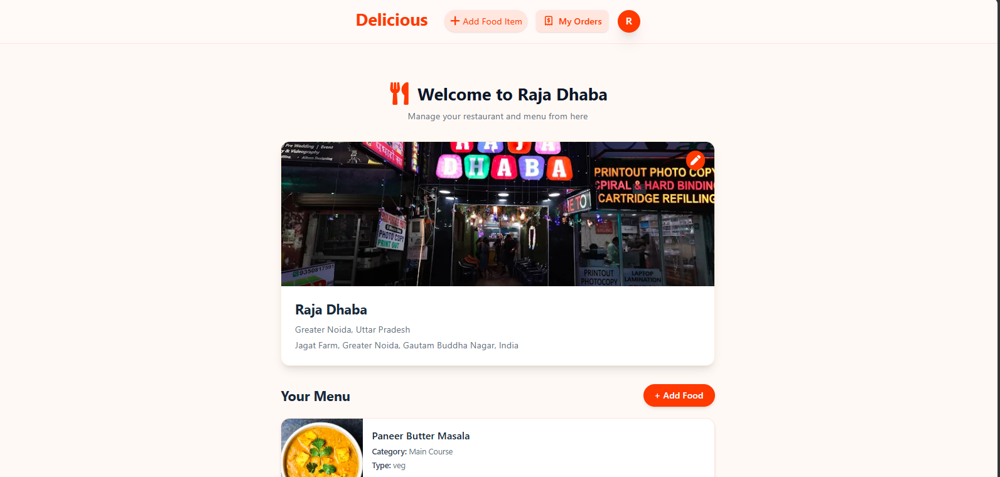

# Delicious - Food Delivery Web Application

## 📌 Overview

Delicious is a full-stack **food delivery web application** built using the **MERN stack**. It allows users to browse restaurants, place food orders, track deliveries, and make payments online. The platform also provides dedicated dashboards for **restaurant owners** and **delivery partners** to manage their operations efficiently.

---

## 🚀 Features

### 👤 User Features

* Browse restaurants and food items
* Add food items to cart
* Place orders using **Cash on Delivery** or **Online Payment**
* View current and previous orders
* Track delivery status in real time
* Select delivery location using map integration

### 🏪 Restaurant Owner Features

* Manage restaurant profile
* Add, update, and delete food items
* Receive real-time order notifications
* View and manage customer orders
* Update order status

### 🚚 Delivery Partner Features

* View assigned deliveries
* Track active deliveries
* Mark orders as delivered
* Monitor completed deliveries and earnings

### ⚡ Core Functionalities

* **Socket.io** for real-time communication
* **Razorpay** integration for secure payments
* **Geoapify API** for location-based delivery features
* **Cloudinary** for image uploads
* **Role-based authentication and authorization**

---

## 🛠️ Tech Stack

### Frontend

* React.js
* Redux Toolkit
* Tailwind CSS
* React Leaflet

### Backend

* Node.js
* Express.js
* MongoDB
* Mongoose

### Integrations

* Socket.io
* Razorpay
* Cloudinary
* Geoapify API

---

---

## ⚙️ Installation & Setup

### 1. Clone the repository

```bash id="r89c8g"
git clone https://github.com/anuragverse/delicious-food-delivery-app.git
cd delicious-food-delivery-app
```

### 2. Install dependencies

#### Backend

```bash id="53al5w"
cd backend
npm install
```

#### Frontend

```bash id="uyplqg"
cd frontend
npm install
```

### 3. Setup environment variables

Create `.env` files in both `backend` and `frontend` using the `.env.example` files.

### 4. Run the application

#### Start Backend

```bash id="6h6vtp"
cd backend
npm run dev
```

#### Start Frontend

```bash id="8smqyy"
cd frontend
npm run dev
```

---

## 🌐 Environment Variables

Copy `backend/.env.example` to `backend/.env` and `frontend/.env.example` to `frontend/.env`, then fill them in.

### Backend (`backend/.env`)

| Variable | Purpose |
| --- | --- |
| `PORT` | Port for local development (default 5000) |
| `MONGODB_URL` | MongoDB Atlas connection string (`MONGO_URI` is also accepted) |
| `JWT_SECRET` | Secret used to sign login tokens |
| `CLIENT_URL` | Allowed frontend origin(s), comma-separated, no trailing slash |
| `CLOUDINARY_CLOUD_NAME`, `CLOUDINARY_API_KEY`, `CLOUDINARY_API_SECRET` | Image uploads |
| `RAZORPAY_KEY_ID`, `RAZORPAY_KEY_SECRET` | Online payments |
| `FIREBASE_API_KEY` | Lets the server verify Google sign-in tokens |
| `BREVO_API_KEY`, `MAIL_FROM` | Emails (password reset, delivery OTP) in production |
| `EMAIL`, `PASS` | Gmail SMTP for local development only |

### Frontend (`frontend/.env`)

| Variable | Purpose |
| --- | --- |
| `VITE_SERVER_URL` | Backend URL, no trailing slash |
| `VITE_GEOAPIKEY` | Geoapify API key |
| `VITE_RAZORPAY_KEY_ID` | Razorpay public key id |
| `VITE_FIREBASE_APIKEY` | Firebase web API key |

---

## ☁️ Deployment

The frontend runs on **Vercel**, the backend on **Render**, the database on **MongoDB Atlas**.

1. **MongoDB Atlas**: create a free M0 cluster and a database user. Under *Network Access* allow `0.0.0.0/0` (Render free instances have no fixed IP). Copy the connection string and add a database name, e.g. `...mongodb.net/delicious?retryWrites=true&w=majority`.
2. **Email (Brevo)**: Render's free tier blocks SMTP, so emails go through Brevo's HTTPS API. Create a free Brevo account, add and verify a sender address (*Senders*), and create an API key.
3. **Backend on Render**: *New -> Blueprint*, pick this repo (it reads `render.yaml`) and fill in the environment variables. Set `CLIENT_URL` to your Vercel URL once you have it. Check `https://<your-service>.onrender.com/api/health`.
4. **Frontend on Vercel**: import the repo, set the **Root Directory** to `frontend`, and add the variables `VITE_SERVER_URL` (your Render URL), `VITE_GEOAPIKEY`, `VITE_RAZORPAY_KEY_ID` and `VITE_FIREBASE_APIKEY`.
5. **Firebase**: *Authentication -> Settings -> Authorized domains* -> add your Vercel domain, otherwise Google sign-in is blocked.
6. Update `CLIENT_URL` on Render with the final Vercel URL (no trailing slash) if you have not already.

Free Render services sleep after about 15 minutes without traffic, so the first request can take up to a minute.

---

## 📸 Screenshots

### 🏠 User Home Page

Users can browse restaurants, food categories, and popular dishes.



---

### 📦 Current Order Tracking

Users can track their active order and monitor delivery progress.



---

### 🚚 Delivery Partner Dashboard

Delivery partners can view assigned orders, active deliveries, and earnings.



---

### 🏪 Restaurant Owner Dashboard

Restaurant owners can manage their restaurant profile, food items, and orders.



---


## 🤝 Contributing

Contributions are welcome. Feel free to fork the repository and submit a pull request.

